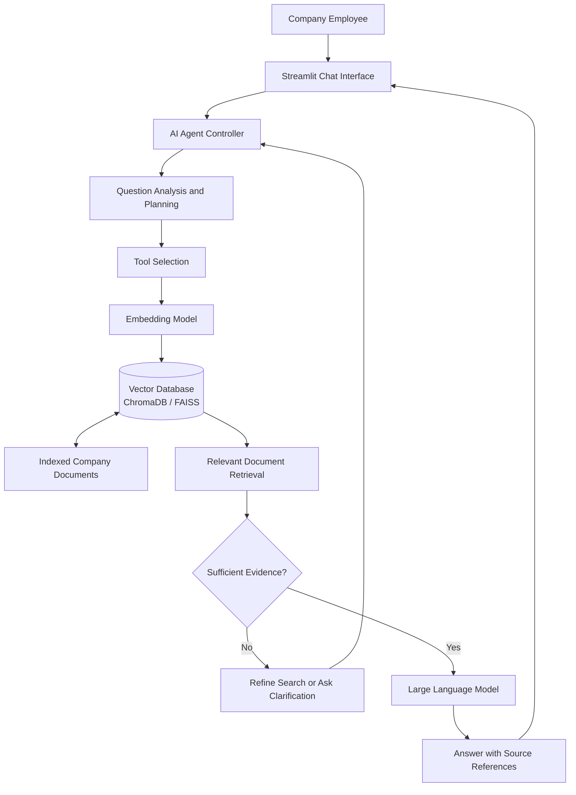

# AI Research Assistant Agent – Project Architecture

## Overview

This architecture demonstrates how an AI Research Assistant Agent connects a user interface, agent controller, document retrieval tools, vector database, and language model to answer questions about company documents.

## Architecture Components

### 1. User Interface

A Streamlit interface allows employees to enter questions and view responses.

### 2. AI Agent Controller

Controls the task execution process and coordinates the tools used by the agent.

### 3. Question Analysis and Planning

Identifies the user's information needs and determines the next action.

### 4. Tool Selection

Chooses the appropriate document retrieval or search operation.

### 5. Embedding Model

Converts questions and document chunks into vectors for semantic similarity search.

### 6. Vector Database

ChromaDB or FAISS can support similarity search over indexed document embeddings.

### 7. Indexed Company Documents

Contains processed company policies, reports, and technical documentation. Access controls should be enforced.

### 8. Relevant Document Retrieval

Returns document sections that match the user's question.

### 9. Evidence Evaluation

Checks whether the retrieved content is sufficient to answer the question.

### 10. Large Language Model

Generates a readable answer grounded in the retrieved evidence.

### 11. Final Response

Displays the answer and available source references to the employee.

## Conclusion

The architecture combines AI agent planning, tool usage, semantic search, and RAG-based response generation to help employees retrieve company information efficiently.
