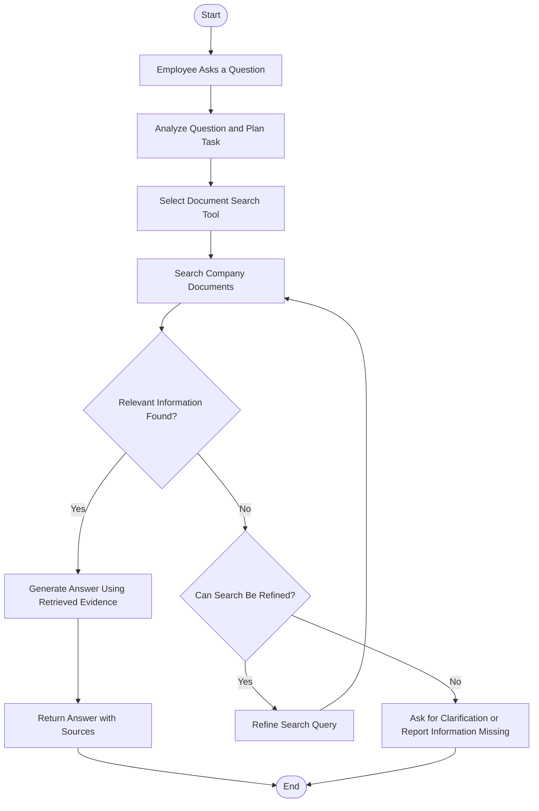

# AI Research Assistant Agent – Workflow Diagram

This workflow illustrates how the AI Research Assistant Agent processes employee questions and retrieves information from company documents.

## Workflow Explanation

1. The employee submits a question.
2. The agent analyzes the question and creates a plan.
3. The appropriate document retrieval tool is selected.
4. The agent searches the company knowledge base.
5. It checks whether relevant information was found.
6. If information is available, the agent generates an evidence-based answer.
7. If information is missing, the agent refines the search or asks for clarification.
8. The final response is returned to the employee.
